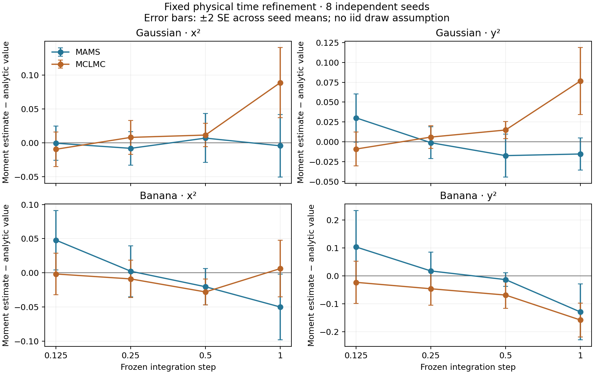

# Frozen-step refinement and controlled search evidence

All 128 planned analytic trials completed: two targets, two methods, four frozen steps, eight seeds. Each trial has 1024 units of warmup physical time and 8192 units of retained physical time, eight macrosteps per transition, and fixed MCLMC refresh length sqrt(2). No adaptation or retry occurs during this experiment. [Raw draws](draws.csv.gz) include repeats; [trials](trials.csv) retain every outcome and actual gradient call count.

The targets have known moments: x is standard normal, y = r + b(x²−1), r is independent standard normal. b=0 gives the Gaussian and b=0.5 gives the banana; E[y²]=1+2b². MAMS supplies a corrected control; it still has finite-chain Monte Carlo error. MCLMC is explicitly approximate.

| Target | Method | Step | E[y²] error | SE across 8 seed means |
| --- | --- | ---: | ---: | ---: |
| banana | mams | 0.125 | 0.10346 | 0.06522 |
| banana | mams | 0.25 | 0.01766 | 0.03365 |
| banana | mams | 0.5 | -0.01334 | 0.01201 |
| banana | mams | 1.0 | -0.12911 | 0.05011 |
| banana | mclmc | 0.125 | -0.02312 | 0.03812 |
| banana | mclmc | 0.25 | -0.04611 | 0.02954 |
| banana | mclmc | 0.5 | -0.06868 | 0.02398 |
| banana | mclmc | 1.0 | -0.15795 | 0.03032 |
| gaussian | mams | 0.125 | 0.03020 | 0.01516 |
| gaussian | mams | 0.25 | -0.00106 | 0.01003 |
| gaussian | mams | 0.5 | -0.01730 | 0.01344 |
| gaussian | mams | 1.0 | -0.01525 | 0.01015 |
| gaussian | mclmc | 0.125 | -0.00902 | 0.01069 |
| gaussian | mclmc | 0.25 | 0.00601 | 0.00712 |
| gaussian | mclmc | 0.5 | 0.01493 | 0.00539 |
| gaussian | mclmc | 1.0 | 0.07657 | 0.02101 |

The banana MCLMC second-moment discrepancy decreases from −0.158 at h=1 to −0.023 at h=0.125. Gaussian y² error decreases from +0.077 to −0.009 over the same endpoints. Fine-step estimates overlap zero at the observed seed uncertainty. This is evidence of refinement on these cases, not a universal bias rate. Intermediate estimates and corrected-control fluctuations remain visible; no monotonicity or success gate was imposed.

Error bars are twice the standard error across independent seed means, not a calibrated coverage claim. Equal physical time does not imply equal mixing, particularly for frequent MAMS direction resampling at small steps. All four moments and all seed outcomes are in [the report](report.json). Reproduce summaries with `python3 analyze_refinement.py DIRECTORY` using a fresh output directory containing trials.csv and draws.csv.gz.

## Original-start cutoff probes

Each target has 28 uncensored one-step probes: four original phases and seven step sizes. The momentum seed is reset at every step size so both cutoff policies inspect exactly the same q,p,h. Earnings has five finite downhill probes rejected by the historical absolute cutoff; sblri has three; AR-K has none on the declared grid. The [raw phase inputs, energy changes and actual calls](search-probes) retain all failures too. The separate [18-job whole-warmup ablation](../posteriordb-complete-v3-ablation/per-target-findings.md) changes the whole controller and quantifies inference and cost; the cutoff probes alone do not apportion that total effect.

## RMHMC numerical comparison

The independent 80-digit Decimal fixture gives 72 Picard/Newton cases across four tolerances and three budgets, plus eight implicit root combinations. Actual Rust maps, iteration counts and failure stages passed their assertions in the [full workspace validation log](workspace-validation.log). The two compiled Stan third-AD oracle tests also executed on dusk: [receipt](third-ad-oracle.log). These analytic/layout checks coexist with the strict SoftAbs symmetry failures in PosteriorDB.

The [finite-map analysis](../../../rmhmc-finite-map-analysis.md) gives an explicit counterexample passing tolerant reverse replay with non-unit determinant. This completes the investigation with a negative finding; it supplies no finite-solver exactness certificate or tight-tolerance bias bound. RMHMC remains exactness-pending.

The [pre-execution specification](targeted-spec.json), [seal](targeted-seal.json), [worker build proof](worker-build.json), source capsule hashes and [output checksums](verification.json) bind this evidence. No compiler ran alongside numerical measurements on dusk.
